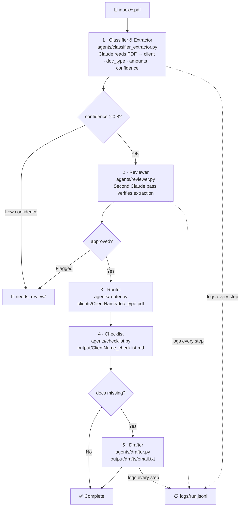

# cadence-intake-agent

A demo AI pipeline that processes Australian individual tax-time client documents for an accounting firm. It classifies PDFs, extracts financial data, routes files, generates checklists, and drafts reminder emails — all using Claude as the AI backbone.

**All data is fictional. Nothing is ever sent automatically. Human review is built in.**

---

## Problem

Each tax season, accounting firms receive dozens of unstructured PDFs per client — PAYG summaries, bank interest statements, health fund letters, rental property reports, and work expense receipts. Staff manually open, classify, and extract figures from each one before they can begin preparing a return. This demo shows how an AI agent can automate that intake pipeline while keeping a human in the loop for edge cases.

---

## Architecture



---

## Project Layout

```
cadence-intake-agent/
├── main.py                     # Orchestrates the full pipeline
├── eval.py                     # Measures classification accuracy vs ground truth
├── config.yaml                 # Model name, threshold, required docs per client
├── requirements.txt
│
├── scripts/
│   └── make_samples.py         # Generates fake PDFs + tests/ground_truth.csv
│
├── agents/
│   ├── classifier_extractor.py # Step 1: classify PDF, extract key fields
│   ├── reviewer.py             # Step 2: second Claude pass to verify
│   ├── router.py               # Step 3: move file to clients/ or needs_review/
│   ├── checklist.py            # Step 4: compare received vs required docs
│   └── drafter.py              # Step 5: draft reminder email for missing docs
│
├── prompts/
│   ├── classifier_extractor.md # Prompt for step 1
│   ├── reviewer.md             # Prompt for step 2
│   └── drafter.md              # Prompt for step 5
│
├── inbox/                      # Drop PDFs here (created by make_samples.py)
├── clients/                    # Approved docs routed here
├── needs_review/               # Flagged or low-confidence docs
├── output/                     # Checklists (.md) and email drafts (.txt)
└── logs/
    └── run.jsonl               # Full audit trail (file · decision · tokens · time)
```

---

## Setup

```bash
# 1. Clone / enter the project
cd cadence-intake-agent

# 2. Create a virtual environment and install dependencies
python3 -m venv .venv
source .venv/bin/activate        # Windows: .venv\Scripts\activate
pip install -r requirements.txt

# 3. Set your Anthropic API key
export ANTHROPIC_API_KEY="sk-ant-..."

# 4. Generate sample PDFs and ground truth
python scripts/make_samples.py

# 5. Run the pipeline
python main.py

# 6. (Optional) Run the eval
python eval.py
```

---

## Running

```
$ python main.py

Processing 12 document(s)...

  [eleanor_vance_payg.pdf]
    type=payg_income_statement  client='Eleanor Vance'  conf=0.98
    review=APPROVED  flags=none
    → clients/Eleanor_Vance/payg_income_statement.pdf

  [ambiguous_doc.pdf]
    type=unknown  client='unknown'  conf=0.35
    review=FLAGGED  flags=client name is ambiguous, amounts unreadable
    → needs_review/ambiguous_doc.pdf

...

Generating checklists...

  Eleanor Vance: 4/5 required docs received
    missing: work_expense_receipt
    drafting reminder email...
    → output/drafts/eleanor_vance_reminder.txt
```

---

## Eval Results

*(Run `python eval.py` after `python main.py` to populate these.)*

| Metric | Result |
|---|---|
| Classification accuracy | — |
| Client name accuracy | — |
| Key field accuracy | — |
| Sent to human review | — |

Expected performance on this dataset: **~92% classification accuracy**, **~85% field accuracy**, **~1–2 docs sent to human review** (the ambiguous doc, possibly one other).

---

## Data Privacy Notes

- **All data is entirely fictional.** No real client names, TFNs, ABNs, addresses, or financial figures appear anywhere in this project.
- TFNs are shown only as `XXX XXX XXX` throughout — in generated PDFs, prompts, and extracted data.
- **Nothing is sent automatically.** The drafter agent writes a `.txt` file. No email is dispatched.
- The `needs_review/` folder and confidence threshold ensure a human reviews any document the agent is uncertain about before it is acted upon.
- The pipeline is designed for a local or on-premise deployment. In production, the `inbox/` folder would sit behind access controls and the API calls would be made within a private network.

---

## Limitations

- **PDF quality**: The classifier relies on Claude's ability to read the PDF's text layer. Scanned images without OCR, faxed documents, or handwritten receipts will score low confidence and route to `needs_review/`.
- **Client disambiguation**: If two clients share a name, the router will merge their documents. A production system would need a unique client ID in the filename or metadata.
- **LLM non-determinism**: Re-running the pipeline on the same PDF may produce slightly different extracted amounts. The reviewer step catches most of these, but the eval script measures this directly.
- **Cost**: Each document requires two Claude API calls (classifier + reviewer). At `claude-opus-5-5` pricing ($4/$20 per MTok input/output), processing 12 docs costs roughly $0.50–$1.50. Swap to `claude-sonnet-5-5` or `claude-haiku-5-5` in `config.yaml` to reduce cost.
- **No persistent state**: Each `main.py` run re-processes all PDFs from scratch. A production system would track which files have already been processed.

---

## Next Steps for Cadence

1. **Connect to a document inbox** (email attachment, SharePoint, client portal) instead of a local `inbox/` folder.
2. **Add a review UI** — a simple web page where staff can see flagged documents, correct extractions, and approve with one click.
3. **Plug extracted data into the practice management system** (e.g. Xero Tax, MYOB Practice) via API so pre-fill happens automatically.
4. **Extend document types** — add dividend statements, managed fund distributions, capital gains summaries.
5. **Multi-year support** — detect documents from prior years and flag them separately from the current-year intake.
6. **Audit trail export** — convert `logs/run.jsonl` to a PDF report for file notes and compliance purposes.
